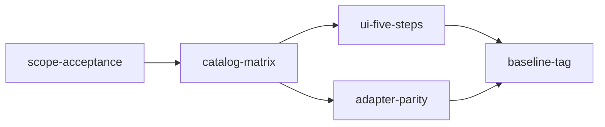

# Spec: hueco MVP-5 (sin implementación)

> **Superseded en cara (2026-10-17).** La UI vigente ya no usa Intención ni Sencillo/Avanzado: el recorrido es Disco y particiones → Sistema base → Entorno → Apps → Identidad y seguridad → Revisión (experiencia única). Las secciones «Cara y pasos» y la pregunta abierta sobre modos describen el estado _previo_ al incremento Forge; no son as-built. El alcance MVP-5 (`mvp5-scope.md`) y este hueco histórico se conservan; el estado vivo de cierre está en `docs/10-delivery/closure/` y ADRs 0013–0018.

- Documento: DOC-DEL-MVP5-GAP-001 · Estado: draft · Propietario: Arquitectura/Release · Fecha: 2026-10-16
- Autoridad de alcance: [`mvp5-scope.md`](mvp5-scope.md) (DOC-DEL-MVP5-001, `accepted`). Este texto no lo sustituye.
- MVP-5-01 cerrado. El alcance autoriza el slice (catálogo, UI de cinco pasos, paridad) bajo sus exclusiones; este hueco no abre runner, ISO ni cifras no verificadas del HTML.
- MVP-5-02 cerrado: las 54 opciones de la matriz están en `local-catalog-mvp1.json` (sin `cmd`/versión/tamaño).
- MVP-5-03 cerrado: cara Forge conectada (gaps deshabilitados; resolve→validate→export). Residual sin control de cara: `zstd`/`xz`, `greetd-tuigreet`, libpacks office/dev/gaming completos.
- MVP-5-04 cerrado: manifiesto del catálogo desktop con bytes canónicos idénticos en nativo y dispatch WASM (`parity_desktop_catalog_manifest_canonical_bytes`).
- MVP-5-05 cerrado: tag anotado `implementation-baseline-mvp5` (tags previos intactos).

## Supuestos

1. La autoridad de alcance es DOC-DEL-MVP5-001. Este documento detalla el hueco; no redefine el alcance.
2. La semántica vive en Rust. Las listas de `apps/web/src/forge-face.ts` son presentación duplicada, no una segunda fuente.
3. Referencia visual histórica (fuera del repo): `/home/alexendros/Aplicaciones/Repertorio/archmaker_neubat.html` (nombre de archivo conservado; no es norma G6). Runtime: `apps/web/`. `reference/v5.1/` sigue inmutable; el canon de opciones sigue siendo [`docs/12-research/html-catalog-matrix.md`](../12-research/html-catalog-matrix.md), regenerado desde `reference/v5.1/index.html`.
4. Versiones y megabytes del HTML siguen «no verificada» (CON-011). Kernel 7.1.2, tamaños y refs pacman literales no entran al catálogo como hechos.
5. ADR-0011 permanece `proposed`. No se crean esquemas de cláusula nuevos.
6. MockCorePort del baseline MVP-4 se queda. La paridad posterior es la de las operaciones CorePort que ya existen, en Tauri y WASM.

## Mapa de capacidades

| Module id          | Responsibility                                                                 | Depends on                        | Issue MVP-5 |
| ------------------ | ------------------------------------------------------------------------------ | --------------------------------- | ----------- |
| `scope-acceptance` | Acto humano de aceptar DOC-DEL-MVP5-001                                        | —                                 | MVP-5-01    |
| `catalog-matrix`   | Cada id de la matriz entra al catálogo local sin `cmd`/versión/tamaño, o hueco | `scope-acceptance`                | MVP-5-02    |
| `ui-five-steps`    | Recorrer base, environment, libpacks, apps y build contra ese catálogo         | `catalog-matrix`                  | MVP-5-03    |
| `adapter-parity`   | El mismo draft produce los mismos bytes de manifiesto en Tauri y WASM          | `catalog-matrix`                  | MVP-5-04    |
| `baseline-tag`     | Tag nuevo solo tras 01–04 y CI verde                                           | `ui-five-steps`, `adapter-parity` | MVP-5-05    |

Orden: `scope-acceptance` → `catalog-matrix` → `ui-five-steps` y `adapter-parity` → `baseline-tag`.

Quedan fuera del mapa, y se pueden cortar sin reescribir lo anterior: tokens Red Hat nuevos, cláusulas ADR-0011, reglas R001–R005 del plan de lanzamiento, copia del HTML a `reference/v5.1`, runner, ISO, shell, `pacstrap` y empaquetado.

## Objetivo

Dejar escrito qué falta para el slice MVP-5 respecto del baseline `implementation-baseline-mvp4`, y qué no se construye.

Cuando el alcance esté `accepted`, el producto debe poder seleccionar, resolver, validar y exportar un draft con las opciones de la matriz, sin escribir imagen ni llamar a pacman. Hasta ese acto, nadie implementa el slice: el propio alcance lo dice en el criterio de salida.

## Cara y pasos (histórico pre-Forge; no as-built)

> **No as-built.** La cara vigente (2026-10-17+) es experiencia única: Disco y particiones → Sistema base → Entorno → Apps → Identidad y seguridad → Revisión. Sin Sencillo/Avanzado. Ver banner superior y `docs/10-delivery/closure/honest-ux.md`.

Texto histórico (estado _previo_ al incremento Forge): la cara externa y la UI de entonces listaban Intención, Sistema base, Entorno, Apps, Identidad, Revisión, más Sencillo/Avanzado.

El canon semántico de MVP-5 siguen siendo cinco pasos de la matriz: base, environment, libpacks, apps, build. Identidad/revisión y (históricamente) Intención/modo dual son o fueron presentación; `archmaker.face.intent`, `archmaker.face.hostname` y `archmaker.face.encrypt` no se promueven a entidades de catálogo.

Sencillo/Avanzado (histórico) no añadía una regla: solo ocultaba opciones. El atributo ausente DE/WM o capa es hueco de `catalog-matrix`, no filtro nuevo en TypeScript ni R005. **Cerrado en cara:** no se restaura el modo dual.

Controles de la cara que no tienen fila en la matriz no se inventan: se dejan sin opción de catálogo.

## Catálogo

Fuente: la tabla entre marcadores de [`html-catalog-matrix.md`](../12-research/html-catalog-matrix.md). Un id «sí» ya está en `crates/archmaker-core/fixtures/local-catalog-mvp1.json`. El trabajo posterior, no este, es cargar o dejar hueco lo que hoy figura «no»:

- base: `linux-hardened` (el campo `cmd` no migra), `limine`
- environment: `cosmic`, `greetd-tuigreet`
- libpacks: office, dev y gaming de la matriz
- apps: `brave`, `discord`, `telegram`, `ghostty`, `kitty`, `micro`, `cursor`, `btop`, `obsidian`, `onlyoffice-standalone`
- build: `zstd`, `xz`

`onlyoffice-bin`, `brave-bin` y `cursor-bin` siguen como `no-redistribuible-candidato`: se conserva el nombre, no el binario. Presets (`minimal-dev`, `full-workstation`, `gaming`) siguen deferred (FR-PRESET-001). Bootloader preseleccionado en la cara UEFI: `archmaker.boot.systemd-boot`; GRUB y Limine siguen seleccionables cuando Limine esté en catálogo o marcado como hueco. No se afirma el paquete `systemd-boot` del HTML como hecho: la revisión de arranque ya registra que viaja en `systemd`.

## Reglas

Las cuatro del HTML, ya inventariadas, se reescriben solo al AST aceptado. No se copia `count_gt`.

- `single-compositor` → RULE-COMP-001
- `kernel-required` → RULE-KERNEL-001
- `browser-required` → RULE-BROWSER-001
- `gdm-auto` → RULE-DM-001

RULE-GPU-001 (Sway + NVIDIA) sigue no implementable. No entran avisos de tamaño, snapper, paquetes custom ni la prohibición de i3/Hyprland/Sway en modo sencillo.

## Paridad y contratos

Las operaciones CorePort ya existentes devuelven el mismo manifiesto en Tauri y WASM (NFR-DET-001, NFR-PORT-001). La remediación operativa añade build WASM de navegador (`tools/build-wasm.sh`), `WasmCorePort` y selección explícita de adaptador; `MockCorePort` queda solo para `?mock=1` / pruebas. La exportación entrega bytes al usuario. Ningún adapter ejecuta shell.

## Comandos (cuando el slice esté autorizado)

- `cargo test --workspace`
- `pnpm test` en `apps/web`
- `python3 tools/html_catalog_matrix.py` y el job que regenera la matriz
- `sha256sum --check --strict reference/v5.1/SHA256SUMS`

No forman parte de esta especificación de hueco: `cargo tauri build` de release firmado. El tag `implementation-baseline-mvp5` (MVP-5-05) ya está emitido. El build WASM de desarrollo/CI sí forma parte de la remediación operativa.

## Estructura que este ciclo no toca

- `reference/v5.1/` y sus hashes
- Contratos en `contracts/json-schema/` salvo extensiones mínimas de CorePort documentadas
- `docs/00-governance/go-no-go.md` (veredicto sin ampliar a runner/ISO)
- `docs/10-delivery/mvp5-scope.md` (accepted; no reescribir issues cerrados)

## Estilo

Rust sigue siendo la única autoridad semántica. TypeScript declara la frontera CorePort y pinta DTO. Identificadores canónicos `archmaker.*` ya usados en la matriz. Sin `cmd`, hooks ni strings de shell en catálogo ni en UI.

## Pruebas (del slice futuro, no de ahora)

- Cada id de la matriz está en el fixture o en la lista de huecos, y el corpus de esquema sigue en verde.
- Un draft de los cinco pasos resuelve, valida y exporta sin ISO.
- Paridad: mismos bytes de manifiesto en Tauri y WASM.
- Las cuatro reglas conservan sus diagnósticos actuales. No hay test nuevo de Sway+NVIDIA como aviso implementable.
- `sha256sum --check --strict` de `reference/v5.1/SHA256SUMS` no cambia.

## Límites

- No root, discos, shell, sidecars, `pacstrap`, `mkarchiso`, catálogo remoto ni firma de catálogo.
- No rediseño, no paquete `packages/tokens`, no sustituir la tipografía como trabajo de este hueco.
- No copiar el HTML del 16 oct a `docs/05-ux/reference/` ni a `reference/v5.1/`.
- Este documento no autoriza tag de baseline ni fusión de producto a `main` bajo el veredicto vigente.

## Hecho de esta especificación

- El mapa y los cinco módulos quedan nombrados, con dependencias en un solo sentido.
- La cara externa queda citada y separada de la evidencia hasheada.
- El catálogo pendiente está listado desde la matriz, sin versiones.
- Las cuatro reglas quedan ancladas a las fichas existentes; R001–R005 no entran.

## Preguntas abiertas

- Quién firma MVP-5-01. No es un cambio que este documento aplique solo.
- ~~Si Sencillo/Avanzado se queda como filtro de vista o metadato de catálogo.~~ **Cerrada (cara Forge):** experiencia única; sin modo dual. El atributo ausente DE/WM sigue siendo hueco de catálogo, no regla nueva.

## Trazabilidad

- Alcance: DOC-DEL-MVP5-001 (`mvp5-scope.md`).
- Matriz: DOC-RES-HTML-001.
- Requisitos del slice (cuando se autorice): FR-CAT-001, FR-DRAFT-001, FR-RESOLVE-001, FR-VALIDATE-001, FR-MANIFEST-001, FR-EXPORT-001, NFR-DET-001, NFR-ACC-001, NFR-OFF-001, NFR-PORT-001.
- Riesgos: RSK-004, RSK-009.
- Amenazas: THR-IMP-001.
- Sustituye / sustituido por: —.
